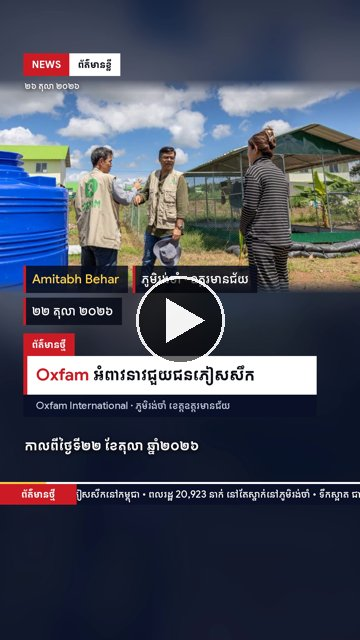

<p align="center">
  
</p>

# Khmer TTS

Turn Khmer text into natural speech in **any voice**, and turn that speech into a ready-to-post
TikTok / Reels / Shorts video.

- **Clone a voice** from a short 4–9 second recording
- **Read Khmer text aloud**: a sentence, or a whole article
- **Make vertical videos** with captions, cards and sound effects

Built on [VoxPocket](https://huggingface.co/muyleanging/VoxPocket-TTS-Khmer), a Khmer model based on VoxCPM 1.5.

## Example

A news video made from one article, voiced with the `rfi` voice:

<a href="docs/example.mp4"></a>

▶️ [Watch the video](docs/example.mp4)

## Requirements

- Python 3.12
- `ffmpeg`
- An NVIDIA GPU (4 GB is enough) or an Apple Silicon Mac
- The [Google Sans](https://fonts.google.com/specimen/Google+Sans) font, for videos

## Install

```sh
python3.12 -m venv .venv-voxpocket
.venv-voxpocket/bin/pip install -r requirements.txt
alias ktts='.venv-voxpocket/bin/python -m khmer_tts'
```

The model (~2 GB) downloads on first use.

<details>
<summary>Mac only: fix Khmer text in videos</summary>

```sh
brew install fribidi
sudo ln -s /opt/homebrew/lib/libfribidi.dylib /usr/local/lib/
```
</details>

## Quick start

```sh
ktts voices                                      # list available voices
ktts speak --voice rfi "សួស្តីបងប្អូនទាំងអស់គ្នា។"     # say one sentence
ktts read  --voice rfi texts/article.txt         # read a whole text file
ktts make  --voice rfi texts/article.txt         # text -> narrated TikTok video
```

Results are saved in `outputs/`.

## One command: text to video

```sh
ktts make texts/article.txt --voice rfi                                # explainer style
ktts make texts/article.txt --voice rfi --images videos/images/my_news # news style with your photos
```

It prepares the text, adds a spoken greeting and sign-off, records the voice, writes the storyboard and
renders `outputs/video_article/tiktok_rfi.mp4`. Use `--kind tutorial`, `promo` or `advice` for other kinds of video.
News-style videos take the news site's branding colours from the article URL (storyboard `source`; sites are listed in
`SITE_THEMES` in `khmer_tts/news_video.py`, e.g. Thmey Thmey blue and red); a storyboard `theme` overrides them.

Every step leaves a file you can edit: `texts/article_tts.txt` (what is read) and `videos/article.json`
(scenes, captions, on-screen facts). Edit them and run the same command again. Only the lines you changed
are re-recorded, so a fix takes about a minute instead of the whole narration. `--redo` rebuilds both files
from the source.

## Make videos with Claude Code

The easiest way to make a video is to open this folder in [Claude Code](https://claude.com/claude-code) and
describe the video you want. It writes the Khmer script, records the voice and renders the video for you.

**News video** from an article link:

```text
Make a TikTok news video from https://www.thmeythmey.com/detail/123456 using the rfi voice
```

**Comparison video** between two things:

```text
Make a TikTok video comparing Laravel and Spring Boot for Khmer developers, using the general voice
```

**Tutorial video** with step-by-step screens:

```text
Make a step-by-step TikTok tutorial in Khmer on how to deploy a website to Vercel, using the general voice
```

**Promotion video** for a product or project:

```text
Make a 60-second promotion video in Khmer for my app Sevakam, a marketplace for booking trusted home-service workers in Cambodia.
Use the advice voice and end with a call to sign up.
```

**Facebook Story** from a photo and a song (lyrics, sound visualizer, camera moves; no voice needed):

```text
Make a 1-minute Facebook Story from photo.jpg with this song: https://www.youtube.com/watch?v=us7rjA44AIE
```

By hand: `python -m khmer_tts song URL --out videos/audio/<song>` (song, vocals, sung phrases), then
`python -m khmer_tts song videos/audio/<song> --align lyrics.txt --from A --to B` (lyric timings), then
write a `"style": "story"` storyboard (see `videos/hometown_story.json`) and run `python -m khmer_tts video` on it.

## Voices

| Voice | Sounds like | Good for | Reference clip |
|---|---|---|---|
| `rfi` | news anchor | news | 5.0 s of broadcast news |
| `general` | casual tech TikToker | coding tutorials | 6.6 s |
| `advice` | calm, warm narrator | advice, quotes, told stories | 6.3 s, voice separated from music |
| `edu` | gentle, heartfelt narrator | advice, parenting, education | 7.3 s from an "edu" Facebook reel, voice separated from music (Demucs) |
| `edu_clean` | same as `edu`, cleaned | compare with `edu`, keep the better one | same clip with `--clean` |

## Clone a new voice

You only need a short recording of one person speaking Khmer: a video, podcast, voice message or
news clip (mp3, wav, m4a, mp4…).

### The easy way: ask Claude Code

```text
Clone a new voice called "sokha" from recordings/sokha.mp3
```

It finds a good clip, writes down what is said, adds the voice and plays a test sentence for you.

### By hand

**1. Find a good clip.** Pick 4–9 seconds where only one person speaks: no music, no background noise,
and the clip ends on a pause. This command lists good places to cut:

```sh
ktts clips recordings/sokha.mp3
```

**2. Write down exactly what is said** in that clip, word for word, in Khmer.

**3. Add the voice.** Use the start time and length of your clip:

```sh
ktts add-voice sokha recordings/sokha.mp3 --start 12.5 --duration 6 \
    --text "ពាក្យដែលនិយាយក្នុងឃ្លីបនេះ"
```

For a noisy or quiet recording, add `--clean`. Leave it off for clean audio: the model copies the
cleaning sound too.

**4. Test it:**

```sh
ktts speak --voice sokha "សួស្តីបងប្អូនទាំងអស់គ្នា។"
```

Listen to the result in `outputs/samples_sokha/`. To try a different clip, run step 3 again with
`--overwrite`.

**If the voice sounds wrong:**
- Check the transcript first. A wrong word is the most common cause of a bad clone.
- Try another clip that is clearer, or 1–2 seconds longer or shorter.
- Try with and without `--clean` and keep whichever sounds better.

Voices are saved in `voices/<name>/` and show up in `ktts voices`.

## Tips for long text

The model reads short phrases best, and can't read digits or symbols. `ktts prepare` fixes this for you:

```sh
ktts prepare texts/article.txt        # -> texts/article_tts.txt
ktts read --voice rfi texts/article_tts.txt
```

It puts **one short phrase per line**, writes numbers, dates, times, `%` and `$` as Khmer words
(`២៩` → `ម្ភៃប្រាំបួន`, `18/11/2026` → `ថ្ងៃទីដប់ប្រាំបី ខែវិច្ឆិកា ឆ្នាំពីរពាន់ម្ភៃប្រាំមួយ`), writes `ៗ` out in full
(`សំខាន់ៗ` → `សំខាន់សំខាន់`), and removes links, source lines, bullets and English text in brackets.
Read the result once before using it: remove the title and byline if you don't want them spoken.

Each line is saved separately in `parts/`, so you can redo a single bad line.

## Included voices

| Voice | Description |
|-------|-------------|
| `rfi` | RFI Khmer news reader |
| `general` | Tech TikTok narrator |
| `advice` | Calm life-advice narrator |
